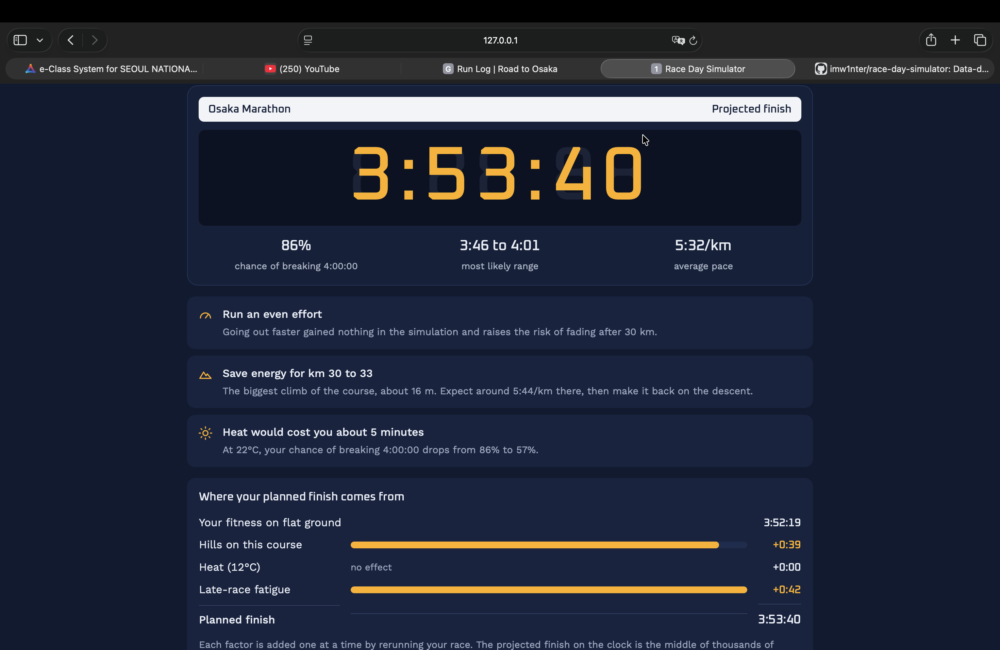
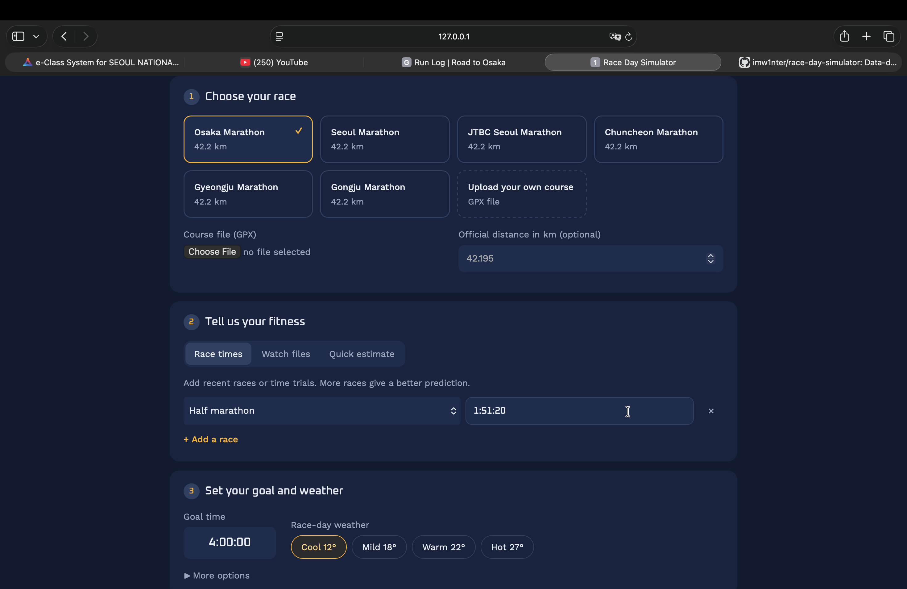
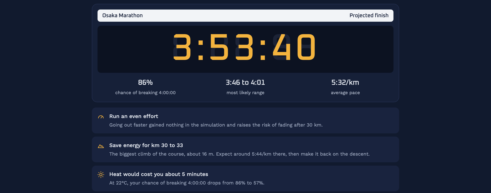
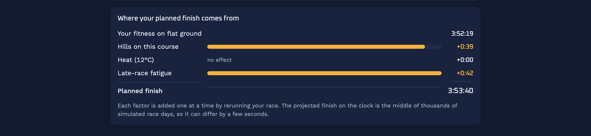
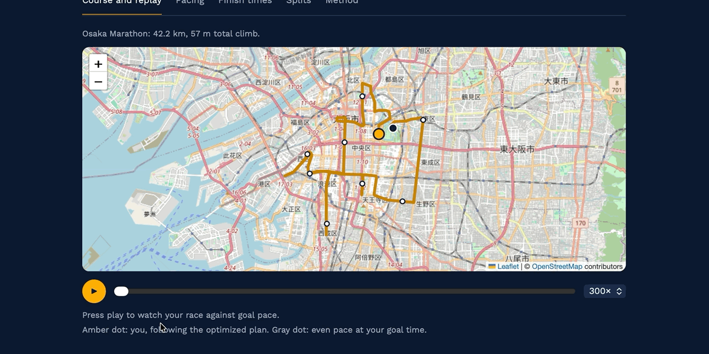
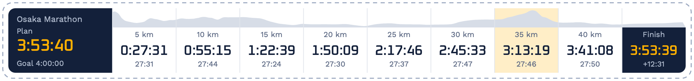
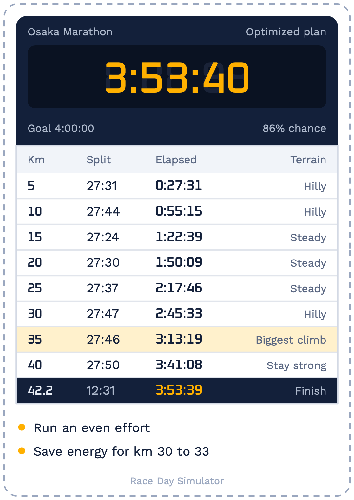

# Race Day Simulator

**See your marathon finish time before race day.**

Race Day Simulator is an open-source web application that predicts and plans a runner's race. It models the real course (hills from GPS elevation data), the runner's current fitness (from race times or watch files), and race-day weather. It then searches for the best pacing plan and runs the race thousands of times to turn one prediction into a probability, like *"86% chance of breaking 4:00:00."*



> Term project for the Open Source Software course, 2026. Built by Muhammad Afiq Farhan ([@imw1nter](https://github.com/imw1nter)).

---

## Contents

- [Features](#features)
- [Demo](#demo)
- [Quick start](#quick-start)
- [How to use it](#how-to-use-it)
- [How it works](#how-it-works)
- [Handling real-world data](#handling-real-world-data)
- [Architecture](#architecture)
- [Project structure](#project-structure)
- [API](#api)
- [Testing](#testing)
- [What I implemented vs. what I used](#what-i-implemented-vs-what-i-used)
- [Third-party libraries and assets](#third-party-libraries-and-assets)
- [Data sources](#data-sources)
- [References](#references)
- [Limitations and future work](#limitations-and-future-work)
- [Use of AI assistance](#use-of-ai-assistance)
- [License](#license)

---

## Features

**Simulation engine (Python)**
- **Course model:** reads any race course from a GPX file, splits it into 100 m segments, smooths noisy GPS elevation, and computes the slope of every segment.
- **Fitness model:** finds your best efforts (1 km to half marathon) in watch files or uses race times you enter, then fits a personal fatigue curve to predict your time at any distance.
- **Course and weather models:** hills (energy cost of running on slopes), heat (temperature and dew point), and late-race fatigue each slow every segment of the race.
- **Pacing optimizer:** tests about 200 pacing plans that use the same average effort and keeps the fastest, so you learn *how* to run the course, not just how long it takes.
- **Monte Carlo simulation:** runs 2,000 race days with random variation in fitness, form, weather, and fatigue, giving a finish-time distribution and the chance of reaching your goal.
- **Time breakdown:** shows exactly how many seconds the hills, heat, and fatigue add to your flat-ground fitness.
- **Plain-language takeaways:** how to pace it, where the course is hardest, and what the weather costs you.

**Web app**
- Guided three-step setup: course, fitness, then goal and weather (with presets).
- Three built-in courses (Osaka, Seoul, Chuncheon), or upload your own GPX course.
- Fitness from race times, watch files (GPX, FIT, TCX, including treadmill runs), or a single quick estimate.
- A "finish gantry" result with an animated race clock.
- Interactive course map with an animated **ghost-runner replay** against goal pace.
- Elevation profile with your planned pace, finish-time histogram, strategy comparison, and splits every 1, 5, or 10 km.
- Printable **pace band** (wrist strip) and **pace card** (pocket card) as PNG images.
- Light and dark mode, keyboard accessible, and works on phones.

---

## Demo

<!-- TODO: add your screenshots to docs/images/ with these names (see "Adding screenshots" below) -->

| Guided setup | Finish gantry and takeaways |
|---|---|
|  |  |

| Time breakdown | Ghost-runner replay |
|---|---|
|  |  |

| Pace band | Pace card |
|---|---|
|  |  |

### Flat vs. hilly courses

The same runner (marathon fitness 3:30:00, cool weather) on three courses:

<!-- TODO: fill in from your own runs of the simulator -->
| Course | Total climb | Planned finish | Hills add | Recommended strategy |
|---|---|---|---|---|
| Osaka Marathon | ~57 m | TODO | TODO | Even effort |
| Seoul Marathon | ~63 m | TODO | TODO | TODO |
| Chuncheon Marathon | ~161 m | TODO | TODO | TODO |

---

## Quick start

**Requirements:** Python 3.12 or newer (developed and tested on Python 3.14), and an internet connection in the browser (the map, charts, and fonts load from public CDNs).

```bash
# 1. Get the code
git clone https://github.com/imw1nter/race-day-simulator.git
cd race-day-simulator

# 2. Create and activate a virtual environment
python3 -m venv venv
source venv/bin/activate          # Windows: venv\Scripts\activate

# 3. Install the dependencies
pip install -r requirements.txt

# 4. Start the app (opens your browser automatically)
python run.py
```

The app runs at **http://127.0.0.1:8000/**. Stop it with **Ctrl+C**.

For development, use auto-reload instead:

```bash
python -m uvicorn app.main:app --reload
```

Interactive API documentation is available at **http://127.0.0.1:8000/docs**.

---

## How to use it

1. **Choose your race:** pick a built-in course or upload a GPX file of your own course.
2. **Tell it your fitness**, in one of three ways:
   - **Race times:** add recent results, e.g. 5 km in 21:47 and a half marathon in 1:52:33.
   - **Watch files:** upload GPX, FIT, or TCX files from your watch. They're combined with any race times you added.
   - **Quick estimate:** type your current fitness as a single time.
3. **Set your goal and weather:** choose Cool, Mild, Warm, or Hot, or set the exact temperature and dew point under *More options*.
4. **Simulate my race**, then explore the results: the gantry clock, takeaways, time breakdown, and the tabs for the course replay, pacing, finish-time distribution, splits, and the method.
5. **Download a pace band or pace card** in the Splits tab, print at 100% scale, and cut along the dashed line.

> **No watch files needed.** Graders can try everything with race times or the quick estimate.

<!-- TODO: once sample_data/sample_run.gpx exists, mention it here -->

---

## How it works

```
 Course (GPX) ─┐
               ├─▶ 1. Course model ─▶ 3. Course & weather models ─▶ 4. Pacing optimizer ─▶ 5. Monte Carlo ─▶ Results
 Fitness ──────┴─▶ 2. Fitness model ────────────────┘
```

### 1. Course model (`engine/course.py`)

The GPX track is resampled into equal **100 m segments** by interpolating between GPS points. Elevation is smoothed with a **moving average over 5 segments (500 m)** to remove GPS noise while keeping real hills. The grade of each segment is the elevation change divided by its length. For built-in courses, the GPS distance is scaled to the official distance (42.195 km), because GPS traces rarely measure a course exactly.

### 2. Fitness model (`engine/fitness.py`)

- **Best efforts:** for each run, a sliding window finds the fastest stretch covering 1 km, 3 km, 5 km, 10 km, and the half marathon, interpolating the exact moment each distance is reached.
- **Personal fatigue curve:** best efforts are fitted to Riegel's endurance formula,

  `T₂ = T₁ × (D₂ / D₁)^k`

  where `k` (the fatigue exponent, classically 1.06) is estimated per runner by a straight-line fit on a log-log scale. It is limited to 1.03–1.15, because training efforts aren't all-out races.
- **Prediction:** each best effort predicts a time for the target distance, and the most optimistic prediction is used.
- **Race times** entered manually are merged with watch-file efforts; the faster time wins for each distance.

### 3. Course and weather models (`engine/models.py`)

Each model returns a **pace multiplier** (1.00 means no change). The pace of a segment is the base pace times all three.

| Model | How it works |
|---|---|
| **Hills** | Energy cost of running on a slope `i`, from Minetti et al. (2002): `C(i) = 155.4i⁵ − 30.4i⁴ − 43.3i³ + 46.3i² + 19.5i + 3.6` J/kg/m. The multiplier is `C(i) / C(0)`. Downhill, runners get only **half** the theoretical gain (braking and form), a design choice of this project. |
| **Heat** | Temperature plus dew point (both in °F) mapped to a slowdown: ≤100 → 0%, 110 → 0.5%, 120 → 1%, 130 → 2%, 140 → 3%, 150 → 4.5%, 160 → 6%, 170 → 8%, 180 → 10% (linearly interpolated). This is a heuristic widely shared among runners, not a peer-reviewed model. |
| **Fatigue** | Pace stays steady until 70% of the race, then drifts slower quadratically, reaching +3% at the finish. |

### 4. Pacing optimizer (`engine/pacing.py`)

A pacing plan is an **effort profile** for every segment, controlled by two settings:
- **Hill response:** 0 = even pace (same pace everywhere), 1 = even effort (slow on climbs, fast on descents).
- **Split:** whether effort rises (negative split) or falls (positive split) during the race.

Every profile is scaled to the **same average effort**, so plans are compared fairly. Running above sustainable effort builds **strain**, which makes late-race fatigue worse; going out too fast or attacking hills has a cost later. The optimizer searches a grid of 16 hill responses (0–1.5) × 13 splits (−6% to +6%), **208 simulated races**, and keeps the fastest. The simulation runs segment by segment, because strain from earlier segments affects later ones.

On flat courses the optimizer chooses an even effort, which matches standard marathon advice. On hilly courses it moves toward pushing slightly on climbs and easing off on descents.

### 5. Monte Carlo simulation (`engine/montecarlo.py`)

Each simulated race day draws random values:

| Factor | Variation |
|---|---|
| Fitness vs. prediction | ±2% (normal) |
| Race-day form | ±1.5% (normal) |
| Temperature | ±2 °C around the forecast |
| Dew point | ±2 °C, never above the temperature |
| Late-race fatigue | median 3%, log-normal spread 0.5 (a long tail models occasionally "hitting the wall") |

These spreads are **modeling assumptions**, collected in one `Uncertainty` class so they're easy to adjust.

**Vectorization:** instead of looping over 2,000 races × 422 segments in Python, `simulate_many` computes all races at once as a NumPy grid (one row per race, one column per segment). A test checks that it gives exactly the same result as the step-by-step `simulate`.

**Common random numbers:** the main simulation and the weather comparison use the same random seed, so both see the same random race days, and the difference between them comes only from the weather. This makes "heat would cost you X minutes" precise and makes results reproducible.

### Time breakdown and takeaways

The **time breakdown** reruns the planned race four times, adding one factor at a time (flat and cool with no fatigue, then hills, then heat, then fatigue), so the parts always add up exactly to the planned finish.

The **takeaways** come from the optimizer's chosen strategy, the 3 km stretch with the most elevation gain, and a comparison with a cool (12 °C) or warm (22 °C) day.

---

## Handling real-world data

Real GPS data is messy. Problems found during development and how they're handled:

| Problem | Solution |
|---|---|
| GPS measures a race slightly short (e.g. a 5 km race as 4.97 km), so the run never "reaches" 5 km | Runs within **2%** of a target distance count, with the time scaled to the full distance |
| Duplicate timestamps split runs into pieces | Points with the same timestamp are skipped |
| Several activities in one file, or time going backwards | A new piece starts when time goes backwards or pauses for more than 10 minutes |
| Single GPS glitches (jumps of hundreds of meters) | Points implying speeds above 10 m/s are dropped |
| Treadmill runs have no GPS distance | FIT and TCX files use the distance measured by the watch; indoor GPX files are skipped with advice to export FIT or TCX |
| Unreadable, unsupported, or hidden system files | Skipped with a clear reason instead of crashing |
| Watches writing non-standard FIT fields | Harmless decoder warnings are silenced |

---

## Architecture

```
┌──────────────── Browser (frontend/) ────────────────┐        ┌──────────── Server (app/ + engine/) ────────────┐
│ index.html, style.css, app.js                        │        │ FastAPI (app/main.py)                            │
│ Form ──▶ FormData (files, race times, settings) ─────┼──POST─▶│ validate input, save uploads to a temp folder    │
│                                                      │  /api/ │ engine: course ▶ fitness ▶ pacing ▶ Monte Carlo  │
│ Gantry, takeaways, breakdown, map (Leaflet),         │◀─JSON──┤ delete temp files, return results as JSON        │
│ charts (Chart.js), replay, pace band/card (canvas)   │        │                                                  │
└──────────────────────────────────────────────────────┘        └──────────────────────────────────────────────────┘
```

The engine is plain Python with no web code, so it can be tested and used on its own. The server only connects it to the browser.

**Security and privacy**
- Uploaded files go to a temporary folder that is **deleted after every request**. Nothing is stored.
- Uploaded file names are reduced to their base name, blocking **path traversal** (e.g. `../../file`).
- All input is validated: time formats, temperature range, dew point not above temperature, at most 30 files of 20 MB, at most 20 race times, and no impossible speeds.
- The frontend inserts user-provided text with `textContent`, never `innerHTML`, preventing **cross-site scripting (XSS)**.

---

## Project structure

```
race-day-simulator/
├── app/
│   └── main.py            # FastAPI server: endpoints, validation, insights
├── engine/
│   ├── course.py          # GPX course loading, resampling, smoothing
│   ├── fitness.py         # GPX/FIT/TCX reading, best efforts, Riegel fit
│   ├── models.py          # hill, heat, and fatigue models
│   ├── pacing.py          # pacing strategies, optimizer, time breakdown
│   └── montecarlo.py      # vectorized Monte Carlo simulation
├── frontend/
│   ├── index.html         # page structure
│   ├── style.css          # finish-gantry theme, light and dark mode
│   └── app.js             # form, results, map, charts, replay, pace band/card
├── sample_data/           # built-in course GPX files
├── tests/                 # pytest test suite
├── docs/images/           # README screenshots
├── run.py                 # one-command start script
├── requirements.txt
└── LICENSE
```

---

## API

| Method | Path | Description |
|---|---|---|
| `GET` | `/api/health` | Server status |
| `GET` | `/api/courses` | List of built-in courses |
| `POST` | `/api/simulate` | Run a full simulation (multipart form) |

Main `/api/simulate` fields: `course_id` or `course_file` (GPX), `runs` (GPX/FIT/TCX files), `records` (JSON list such as `[{"distance_km": 5, "time": "21:47"}]`), `fitness_time`, `goal_time`, `temp_c`, `dew_c`, `simulations`.

The response contains `course` (distances, elevation, coordinates), `fitness`, `strategies`, `optimized` (segment paces, kilometer splits), `monte_carlo` (statistics and histogram), `insights`, and `breakdown`. Full schema: http://127.0.0.1:8000/docs.

---

## Testing

```bash
python -m pytest
```

47 tests cover:
- **Course:** distance, even segments, realistic grades, smoothing, every built-in course loads.
- **Fitness:** best efforts, short GPS races, duplicate timestamps, distance resets, treadmill and broken files, merging race times.
- **Models:** hill, heat, and fatigue behavior.
- **Pacing:** fair effort profiles, even effort beating even pace on hills, fast starts costing time, the optimizer never losing to simpler strategies, the time breakdown adding up.
- **Monte Carlo:** the vectorized version matching the step-by-step one, reproducible seeds, heat slowing races.
- **API:** successful simulations and rejection of invalid input.

Tests use small generated courses and runs, so they don't depend on private data.

---

## What I implemented vs. what I used

**Implemented by me in this project:**
- The whole simulation engine: course resampling and smoothing, best-effort search, fatigue-curve fitting, the hill/heat/fatigue models as code, the strain-based pacing model and optimizer, the vectorized Monte Carlo simulation, the time breakdown, and the insights.
- GPS data cleaning (short races, duplicates, gaps, glitches, treadmill handling) and the FIT/TCX/GPX loading logic.
- The FastAPI server: endpoints, validation, temporary-file handling, and the JSON response.
- The frontend: layout and design, form logic, results rendering, the ghost-runner replay (binary search and interpolation along the route), and the pace band and pace card drawn on a canvas.
- All tests.

**Used from others (credited below):**
- Published models and formulas: Minetti et al. (2002) for hills, Riegel (1981) for endurance, and a runners' heat heuristic.
- Open-source libraries for reading files (gpxpy, fitdecode), numerical computing (NumPy), the web server (FastAPI, Uvicorn), the map (Leaflet), and charts (Chart.js).
- Map data from OpenStreetMap and course GPS files from the sources listed below.

---

## Third-party libraries and assets

| Name | Used for | License |
|---|---|---|
| [FastAPI](https://github.com/fastapi/fastapi) | Web API framework | MIT |
| [Uvicorn](https://github.com/encode/uvicorn) | Server that runs the app | BSD-3-Clause |
| [python-multipart](https://github.com/Kludex/python-multipart) | Receiving uploaded files | Apache-2.0 |
| [NumPy](https://numpy.org/) | Numerical computing, vectorized simulation | BSD-3-Clause |
| [gpxpy](https://github.com/tkrajina/gpxpy) | Reading GPX files | Apache-2.0 |
| [fitdecode](https://github.com/polyvertex/fitdecode) (Jean-Charles Lefebvre) | Reading FIT files | MIT |
| [pytest](https://pytest.org/) | Testing | MIT |
| [HTTPX](https://github.com/encode/httpx) | Test client for the API | BSD-3-Clause |
| [Leaflet](https://leafletjs.com/) | Interactive map | BSD-2-Clause |
| [Chart.js](https://www.chartjs.org/) | Elevation and histogram charts | MIT |
| [OpenStreetMap](https://www.openstreetmap.org/copyright) | Map tiles and data | Data: ODbL, © OpenStreetMap contributors |
| [Oxanium](https://fonts.google.com/specimen/Oxanium), [Work Sans](https://fonts.google.com/specimen/Work+Sans) (Google Fonts) | Typography | SIL Open Font License |

Other packages in `requirements.txt` are dependencies installed automatically by these libraries.

---

## Data sources

| Course | Source | Notes |
|---|---|---|
| Osaka Marathon | https://www.goandrace.com/en/map/2025/osaka-marathon-2025-osaka-course-map-1.php#goog_fullscreen_ad | 2025 course |
| Seoul Marathon | https://wari-gari.com/routes/donga-marathon#google_vignette | 2026 course |
| JTBC Seoul Marathon | https://marathon.jtbc.com/49/?bmode=view&idx=175326651 | 2026 course |
| Chuncheon Marathon | https://www.runruun.com/posts/90/ | 2026 course |
| Gyeongju Marathon | https://wari-gari.com/routes/gyeongju-marathon | 2026 course |
| Gongju Marathon | https://www.runruun.com/posts/63/ | 2026 course |

The author's personal training runs used during development are **not** included in the repository (they contain GPS locations); `sample_data/runs/` is ignored by Git.

---

## References

- Minetti, A. E., Moia, C., Roi, G. S., Susta, D., & Ferretti, G. (2002). Energy cost of walking and running at extreme uphill and downhill slopes. *Journal of Applied Physiology*, 93(3), 1039–1046.
- Riegel, P. S. (1981). Athletic records and human endurance. *American Scientist*, 69(3), 285–290.
- Temperature plus dew point heat adjustment: a runners' rule of thumb, used here as a heuristic. <!-- TODO: add the source you used -->

---

## Limitations and future work

**Limitations**
- **Riegel's formula is often optimistic for the marathon,** especially for runners without marathon experience. Predictions from short races may be too fast.
- **Some fatigue may be counted twice:** the Riegel prediction already includes some fatigue, and the simulator adds its own, so predictions from watch files lean slightly conservative. Calibrating this would need real race results.
- **The uncertainty values and the strain weight are assumptions,** not measured from data.
- **The "wall" is mild:** the fatigue model costs about a minute even in bad cases, while real collapses can cost 10–20 minutes.
- **The heat model is a heuristic,** not a physiological model.
- **Treadmill distance** depends on the watch's motion sensor or the machine's calibration, and treadmill running is slightly easier than running outdoors.
- **Course elevation comes from GPS files** and may contain errors; courses can change between years.
- **The frontend needs an internet connection** for the map tiles, charts, and fonts.

**Future work**
- A separate "hitting the wall" event with a small probability of a large slowdown.
- Calibrating the model against real race results.
- Speeding up the pacing optimizer with the same vectorization used for Monte Carlo.
- Live weather forecasts for the race date.
- More built-in courses and a public deployment.

---

## Use of AI assistance

Parts of this project were developed with the help of AI coding assistants (Claude by Anthropic) for explanations, code suggestions, debugging, and design mockups. The project idea, modeling decisions, testing, integration, and final code are my own work, and I reviewed and understand all code in this repository.

<!-- TODO: adjust this section to match your course's policy on AI assistance -->

---

## License

This project is licensed under the **MIT License**. See [LICENSE](LICENSE).

---

## Adding screenshots

<!-- Remove this section once the screenshots are in place -->
1. Create the folder `docs/images/`.
2. Run a simulation and take screenshots with **Cmd+Shift+4** (drag to select an area).
3. Save them as `hero.png`, `setup.png`, `results.png`, `breakdown.png`, `pace-band.png`, and `pace-card.png`.
4. For `replay.gif`, record the replay with a screen recorder that exports GIFs, such as the free and open-source [Kap](https://getkap.co/) for macOS. Keep it short (about 5–10 seconds) so the file stays small.